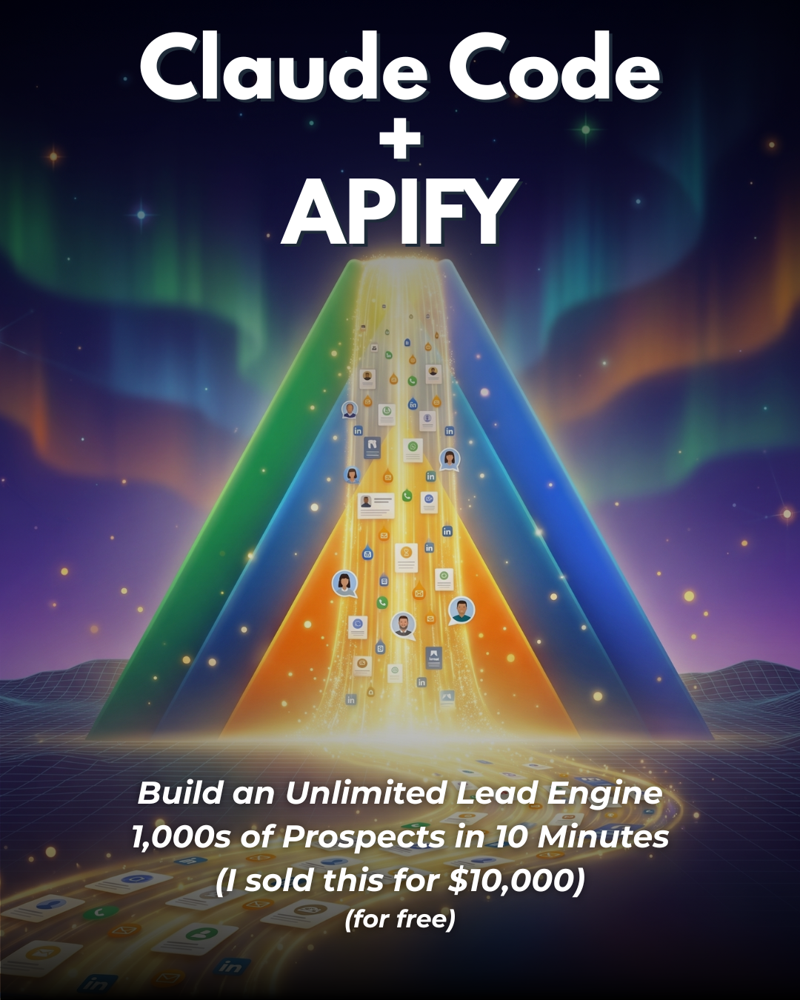

<div align="center">

# 🎠 Carousel Builder for Claude Code

**Build fully branded, viral Instagram carousels end-to-end without leaving your terminal.**



<p align="center">
  <a href="https://github.com/authrain-cloud-abdullahformuli/carousel-builder/blob/main/LICENSE">
    
  </a>
  <a href="https://github.com/authrain-cloud-abdullahformuli/carousel-builder/actions">
    
  </a>
  <a href="https://agentskills.io">
    
  </a>
  <a href="https://authrain-cloud-abdullahformuli.github.io/carousel-builder/">
    
  </a>
</p>

Higgsfield generates a theme-locked cover and middle images. Character budgets keep every line on-template. Canva assembles the deck by duplicating your template and swapping text + images in place. It finishes by generating an engaging Instagram caption for you.

</div>

---

## ⚡ What it does

`/carousel` runs an interview-first, approval-gated pipeline that turns one topic into a finished, on-brand carousel:

1. **Loads your framework** — reads a reference deck (shipped in `examples/template-reference/`) so it mirrors your exact layout: two-tone headlines, one orange highlight word, glow images, CAPS-word body lines.
2. **Interviews the idea** — breaks your topic into 4–6 pillars, each a single component doing one job, plus a CTA keyword + deliverable.
3. **Generates a cover (Higgsfield, 4:5)** — 3–4 options, no baked-in text. The one you pick becomes the **theme anchor** for everything else.
4. **Drafts the copy with live character counts** — every line is budget-checked against real Canva text boxes *before* a single image credit is spent. You approve the draft first.
5. **Generates theme-locked pillar images (Higgsfield, 16:9)** — every middle image is passed the chosen cover as a reference so the whole deck shares one palette, lighting, and mood without visual drift.
6. **Assembles the deck in Canva** — duplicates your template, replaces text span-by-span (preserving the highlight color), and swaps images with `update_fill` so frame glows survive. Nothing is committed until you approve the preview.
7. **Writes the caption** — automatically runs `/short-form-caption` so the post copy and on-slide CTA keyword match.

### `/short-form-caption` (bundled, auto-invoked)

Ships in the same package. `/carousel` calls it as its final step, but it also works standalone on any video transcript or topic blurb. It produces a tight, copy-paste-ready IG/TikTok/Reels caption: CTA on line one, fragment rhythm, exactly 5 hashtags, 500-character hard cap, written in your voice via a fingerprint file.

> **Why character budgets?** Canva text boxes are sized for specific lengths. Go over and the text reflows, the slide stops matching the deck, and the carousel loses its visual unity. Budgets are enforced on the draft so over-length copy never reaches Canva.

---

## 🛠️ Requirements

Two MCP servers, both connected in Claude Code:

| MCP | What it does | Connection |
|---|---|---|
| **Higgsfield MCP** | Image generation (cover + pillar images). Uses the `nano_banana_2` model. | Connect your Higgsfield MCP provider in Claude Code |
| **Canva MCP** | Duplicates your template and edits text + image fills in place. | Add `https://mcp.canva.com/mcp` as an `http` MCP server, then run `/mcp` and authenticate |

You also need an 8-page Canva carousel template you own (see Setup below).

> ### 🎨 Grab the ready-made template
> Open this link and Canva drops a copy straight into your account:
>
> **[canva.link/ydtbp6ujxt22m19](https://canva.link/ydtbp6ujxt22m19)**
>
> Once it's in your Canva, hand the **design ID + the link back to Claude** so it knows exactly what to duplicate and run off of.
>
> Prefer to build your own? **The exact reference deck is also bundled in this repo** at `examples/template-reference/` (8 PNGs) — recreate it in Canva and you have a matching template.

---

## 🚀 Installation

### Option A — Claude Code plugin (recommended)

```bash
/plugin marketplace add authrain-cloud-abdullahformuli/carousel-builder
/plugin install carousel-builder@carousel-builder
```

Restart Claude Code. `/carousel` and `/short-form-caption` are now available.

### Option B — Manual install

Copy the two command files into your commands directory:

```bash
git clone https://github.com/authrain-cloud-abdullahformuli/carousel-builder.git
cp carousel-builder/commands/*.md ~/.claude/commands/        # global
# or, per-project:
cp carousel-builder/commands/*.md /path/to/project/.claude/commands/
```

### Option C — Universal Open Agent Skills Standard (`agentskills.io`)

Compatible with Cursor, Codex, OpenCode, and Antigravity CLI:
```bash
# Skills available in ./skills/
skills/carousel-builder/SKILL.md
skills/short-form-caption/SKILL.md
```

---

## ⚙️ Setup (one time)

Open `commands/carousel.md` and `commands/short-form-caption.md` and replace the placeholders:

| Placeholder | Set it to |
|---|---|
| `<YOUR_CANVA_TEMPLATE_ID>` | The design ID of your 8-page Canva carousel template. |
| `<YOUR_BRAND_VOICE_FILE>` | Path to your brand context file. Start from `config/brand-context.example.md`. |
| `<YOUR_HANDLE>` | Your Instagram handle for the closer slide. |
| `<YOUR_VOICE_FILE>` | Path to your voice fingerprint for captions. Start from `config/voice-fingerprint.example.md`. |

---

## 💻 Usage

```bash
/carousel "Claude Code + Apify for unlimited leads"
```

Or run it bare and it will interview you:

```bash
/carousel
```

Output lands in `content/carousels/{topic-slug}/`:

```text
content/carousels/{topic-slug}/
├── {topic-slug}.md        ← slide copy + char counts + image prompts + caption
├── cover/                 ← 4:5 cover options + the chosen one
├── slides/                ← 16:9 pillar images
└── canva-link.md          ← new Canva edit + view URLs
```

Caption only, from a transcript:

```bash
/short-form-caption ./path/to/transcript.txt
```

---

## 📐 Template Anatomy

| Page | Role | Editable parts |
|---|---|---|
| 1 | **Cover** | Higgsfield 4:5 image + optional Canva text overlay (two-tone headline + italic subtext). |
| 2…N+1 | **Pillars** (4–6) | Two-tone headline `The [Role]: [orange tool] [verb].` + a 16:9 glow image + dark body line ending in ONE ALL-CAPS word. |
| N+2 | **Gift / CTA** | `Comment {KEYWORD} and I'll send {deliverable}.` |
| N+3 | **Closer** | `SAVE / SHARE / FOLLOW` + your handle. Static. |

**Character budgets (hard caps):**
- **Pillar headline:** 45–58 chars (one orange highlighted word)
- **Pillar body:** 65–80 chars (ends with one ALL CAPS word)
- **Cover headline:** ≤ ~22 chars
- **Cover subtext:** 3–4 short italic lines
- **Caption:** ≤ 500 characters total with exactly 5 hashtags

---

## 🌐 Interactive Studio

Test character counts and preview the full 8-slide reference deck in your browser:
**[https://authrain-cloud-abdullahformuli.github.io/carousel-builder/](https://authrain-cloud-abdullahformuli.github.io/carousel-builder/)**

---

## 📄 License

MIT © [Abdullah Formuli](https://github.com/authrain-cloud-abdullahformuli)
